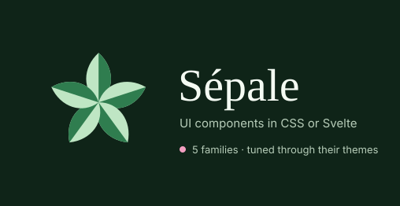

<p align="center">
  
</p>

<p align="center">
  
  
  
  <a href="https://github.com/sponsors/Tyrenn"></a>
</p>

Sépale is a low-key UI component library, available as plain CSS classes or as Svelte 5 components. **Components come first, the CSS after**: each component is a DOM structure and a set of well-defined classes, and an opinionated **family** gives it a look, lightly tuned through its **theme**. Changing family is changing a stylesheet, never the markup.

> *"Sépale" (pronounced *say-pal*) is French for sepal, the small leaf that holds a flower. The families are named after flowers 🌸*

## Features

- 🧱 **Classes before components** : a component is a DOM structure and a set of classes. The Svelte wrapper is the quick way in, not the only one
- 🎨 **Five families**, each with its own themes and its own parameters : pick a visual style, adjust it to your colours
- 🛡️ **Types that match the CSS** : import a family's stylesheet and every prop narrows to what it ships, so a variant it lacks is a compile error
- 📐 **Sized by font-size** : components are `em`-based and carry no breakpoints. Change the font size and the whole component follows
- 🪶 **Plain compiled CSS** : no Tailwind, no `@apply`, no config, no build step. A family is one stylesheet, the reset is optional and separate
- 📊 **Data views included** : a data handler drives filters, sort, search, pages and pending edits. Tables, grids, lists and kanbans only draw its rows
- 🌱 **Families stand alone** : each family writes the whole of every component and reads nothing from another, so one can go far without breaking its neighbours

## Installation

```sh
pnpm add @sepale/components @sepale/style    # or npm install @sepale/components @sepale/style
```

Two packages, to take only what you need :

| Package | Content |
|---|---|
| [`@sepale/style`](https://www.npmjs.com/package/@sepale/style) | The families and their themes, as compiled stylesheets. No dependency, no JavaScript |
| [`@sepale/components`](https://www.npmjs.com/package/@sepale/components) | The Svelte 5 components, typed by the family stylesheet you import. Loads no CSS : `@sepale/style` is an optional peer |

## Quick Start

### With Svelte

```svelte
<script>
	import { Button, Input } from '@sepale/components';
	import '@sepale/style/daisy.css';                  // explicit, never automatic: and it types the props
	import '@sepale/style/daisy/themes/light.css';
</script>

<Input placeholder="Your name" />
<Button color="primary">Save</Button>
```

Importing `daisy.css` narrows every prop to what daisy ships. Switching to `cosmos.css` changes what the compiler accepts, never the runtime : `svelte-check` lists what to fix. With no family imported, the props are generic. To keep code that compiles under several families, see [`@sepale/components`](./packages/components/README.md#types-that-follow-the-family).

### With CSS only

```js
import '@sepale/style/reset.css';              // optional, for a page without a reset
import '@sepale/style/daisy.css';              // a family : every component's classes
import '@sepale/style/daisy/themes/light.css'; // one of its themes
```

```html
<input class="input" placeholder="Your name">
<button class="btn btn-primary">Save</button>
```

## Families

| Family | Look | Themes |
|---|---|---|
| `daisy` | After DaisyUI 5 : flat, crisp borders. A daisyUI theme pasted as-is applies | 35 |
| `dahlia` | After Radix Themes : soft, layered, low contrast | 3 |
| `sunflower` | Neo-brutalist : a heavy black line around everything | 2 |
| `cosmos` | After PaperCSS : hand-drawn | 3 |
| `peony` | The soft SaaS dashboard : tinted page, white cards, wide diffuse shadows | 6 |

A theme is a set of values for its family's parameters, and belongs to that family. One family may expose fifteen colours, another none. To tune your own, use the [theme generator](https://tyrenn.github.io/sepale/theme) and lay the `theme.css` it exports after the family's stylesheet.

## Components

| Group | Components |
|---|---|
| Actions | Button, Link, Join |
| Form | Input, Textarea, Select, Combobox, NumberInput, DatePicker, Calendar, ColorPicker, FileInput, FileDropzone, Checkbox, Radio, Toggle, Switch, Range, Rating, ChipsInput, Editable |
| Form layout | Label, FloatingLabel, Fieldset, Validator |
| Display | Text, Avatar, Badge, Chip, Swatch, Bubble, Card, Stat, Carousel |
| Feedback | Alert, Toast, Loading, Progress, RadialProgress, Skeleton, EmptyState |
| Data | DataHandler, DataControl, Table, Grid, List, Kanban, FileExplorer |
| Navigation | Menu, Tabs, Breadcrumbs, Steps, Pagination, Dock |
| Layout | Navbar, Sidebar, Drawer, Footer, Hero, Divider, Collapse, Accordion |
| Overlay | Dialog, Dropdown, Tooltip |
| Mockups | MobileFrame, WindowFrame, LaptopFrame |

Each one is documented on [the site](https://tyrenn.github.io/sepale/components), with its DOM structure, its classes and a live preview in every family.

## Documentation

1. [Glossary](CONTEXT.md) — family, parameter, theme, component, part, variant, axis, flag, structure / look…
2. [Writing a family](docs/families.md) — what a family holds and how to add one
3. [Decisions](docs/adr/) — the architecture decision records, and *why*
4. [The site](src/routes/README.md) — what is written by hand, what is generated, and which script generates it

## Repository

| Path | Content |
|---|---|
| [`src/lib/components`](src/lib/components) | The Svelte components, written by hand |
| [`src/scss/families`](src/scss/families) | The families, each one directory : the whole of every component, and its themes |
| [`packages`](packages) | The two npm packages, `@sepale/style` and `@sepale/components` |
| [`src/routes`](src/routes) | The [presentation site](https://tyrenn.github.io/sepale/), its theme generator and its component pages |
| [`scripts`](scripts) | The build : CSS, registry, each family's types, the packages, screenshots |

```sh
pnpm run dev                  # compile the families, run the site locally
pnpm run build:css            # compile the families and regenerate the registry
node scripts/shoot.mjs daisy  # screenshot a family's components
```

## Contributing

I develop and maintain Sépale on my own. As such, support and contributions are very welcome — bug reports, ideas, PRs, anything really. If Sépale saves you time, you can also [sponsor its development](https://github.com/sponsors/Tyrenn).

The simplest contribution is to test Sépale and [open issues](https://github.com/Tyrenn/sepale/issues). For code contributions :

1. **Fork** the repository and create a branch from `main` :

	```sh
	git clone https://github.com/<you>/sepale
	cd sepale && pnpm install
	git checkout -b my-change
	```

2. **Make your change**, then look at it : run the site and walk the component in a light and a dark theme, with hover, focus, disabled and checked. A look is judged by rendering. To add a family, follow [`docs/families.md`](docs/families.md).

	```sh
	pnpm run dev
	```

3. **Check everything locally** : it compiles every family and theme, then checks the types.

	```sh
	pnpm run check
	```

4. **Open a Pull Request** against `main`.

### Releasing (maintainer)

```sh
pnpm run package                          # build the CSS and the components into packages/*/dist
pnpm publish ./packages/style             # first : @sepale/components depends on it
pnpm publish ./packages/components
```

## License

[MIT](LICENSE)
